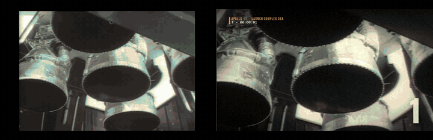
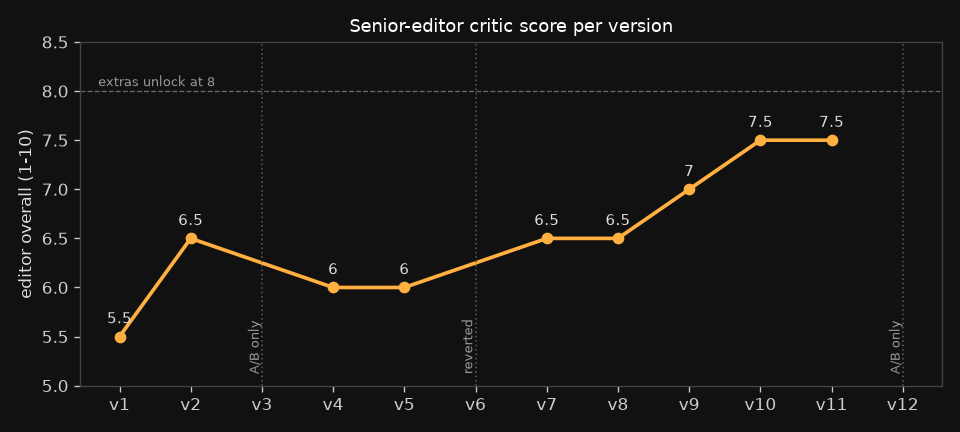
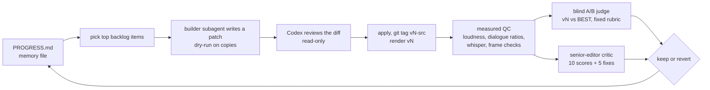

# MOONSHOT

An 81.8-second Apollo 11 trailer, cut overnight by a Claude Code agent loop. Everything in it
is real NASA footage, the real 1969 mission audio, or public-domain orchestral recordings. It ran
on one laptop with no cloud renders and went through twelve versions, each judged by reviewers
that didn't build it.



*Left: the untouched NASA sources at the same edit points. Right: the finished cut.*

## Results in numbers

| | |
|---|---|
| Run | 2026-10-07, 02:43 to about 11:15 EDT, one self-paced agent loop |
| Versions exported | 12 (v1–v12), none overwritten; 1 reverted after losing a blind A/B |
| Editor critic score | 5.5 (v1) → 7.5 (v10, v11) out of 10; the final v12 was a small fix judged by blind A/B |
| Final mix | −13.8 LUFS integrated, −1.5 dBTP true peak; every dialogue line ≥ +11 dB over the bed |
| Blender (EEVEE, headless) | 5 shots in the cut, 1.6–7 s per 1080p frame, 0 cloud renders |
| Defects found by a second model (Codex, read-only) | 11 in pipeline reviews + 3 in a review of the wrap-up scripts, each verified before applying |
| Media | NASA video, photos and audio (public domain) + Commons PD music; about 4.6 GB fetched |



The dip at v4 isn't a worse cut. From v4 on, the critic scored sound from measured loudness and
dialogue ratios, where before it had guessed from frames.

## How the agent worked



- Memory lived in `PROGRESS.md`: the schedule, which version was BEST, the score table, the
  backlog, every instruction the human gave mid-run, tool traps and a resume point. The
  conversation was compacted several times overnight, and each time the loop picked up from that
  file. Anthropic's
  [long-running harness post](https://www.anthropic.com/engineering/effective-harnesses-for-long-running-agents)
  describes the same idea for coding agents.
- `pipeline/build.py` turns three tables (SHOTS, DIALOG, CAPTIONS) into stems and a graded,
  captioned 1080p24 master. Most versions after v1 are a small patch script in `pipeline/patches/`,
  so you can read the edit's history as code.
- Each version went to several reviewers:
  - a senior-editor critic (Fable), which gave 10 scores and the 5 fixes that would help most;
  - a blind A/B judge (Sonnet), which saw unlabeled frame strips per section with a fixed rubric (`pipeline/ab_rubric.md`) and never the key file;
  - "mean Twitter" commenters;
  - a first-time viewer, asked where it would scroll away;
  - a script that measures the audio;
  - once, a historical fact-check against the Apollo Lunar Surface Journal.
- The blind A/B decided keep or revert, with two logged exceptions. In v10 the judge preferred v9
  on two sections, and both picks were misreads of intended changes it couldn't check: a caption
  moved to match the audio, and a countdown "1" taken off the fireball. In v11 it gave v10 two
  low-confidence picks. One was a frame-sampling artefact (the frames are identical); the other,
  a panel placement nit, was fixed in v12, which then won its own A/B. Details in
  [MAKING-OF.md](MAKING-OF.md).
- The loop prompt is in [prompts/moonshot_loop_prompt.md](prompts/moonshot_loop_prompt.md), with
  local paths replaced by placeholders.

## What broke

The full list is in [MAKING-OF.md](MAKING-OF.md#what-broke-and-what-it-taught). The short one:
- A one-frame white flash rendered black, then went missing. The decode pipe was re-timing
  frames, which also pushed everything after 56 s one frame late.
- For four versions the ignition "drop" measured quieter than the countdown before it.
- One caption ran 1.7 s early for seven versions, because I'd placed it by guess.
- A regex edited a comment instead of the code. The blind judge happened to like the result.
- The "title in the plate" experiment lost its A/B and was reverted.
- The alpha craft apps barely made it into the final pipeline. EffectCraft built the v1 title over
  MCP, and Blender replaced it in v3.

## Raw vs final

| | |
|---|---|
|  |  |
|  |  |
|  | |

## Reproduce

This repo is a record of one run more than a turnkey tool. Rebuilding the cut takes several
manual steps, and one of them depends on a tool that isn't included. It was built and run on
Windows 11 only. The graphics use two Windows system fonts (Bahnschrift, Consolas). You need
Python 3.11+ with numpy, Pillow and scipy, ffmpeg 6+, and Blender 5.x.

1. Set `CRAFTWORK` to an empty workspace folder and run `python pipeline/fetch_assets.py`. It
   downloads the NASA media, the Commons music and the NASA Moon Kit into the layout `build.py`
   expects. Its docstring lists four things to get by hand: the Sonniss bundle (into
   `$CRAFTWORK/sfx/sonniss-gdc2024`), the Blue Marble texture (downsample it to an 8K
   `bluemarble_8k.jpg`), the Poly Haven HDRI, and the Anton and Bebas Neue fonts.
2. Render the 3D plates with the scripts in `pipeline/blender/`
   (`blender -b --factory-startup --python <script> -- <args>`) into the folders `build.py` names:
   `title3d_blender`, `moon_blender`, `ascent_blender_v4`, `px_earthrise_v2` and `px_aldrin`,
   under `$CRAFTWORK/inbox/moonshot/work/`. The parallax scripts need their plates first:
   `split_earthrise.py` and `split_aldrin.py`. The Aldrin matte came from a BiRefNet cutout.
3. Synthesise the heartbeat, tick and alarm stem:
   `python pipeline/audio/score.py --cues pipeline/cues.json --out $CRAFTWORK/inbox/moonshot/work/audio`.
4. Clean the mission-audio windows listed in `build.py`'s DIALOG table into
   `$CRAFTWORK/inbox/moonshot/work/restore/`. The run used `craft_tools.restore audio` (RNNoise,
   EQ, compression), which isn't in this repo. Any decent speech cleanup at 48 kHz will do, but
   the levels will differ.
5. Build and check:

```bash
python pipeline/build.py shots 1 && python pipeline/build.py dialog 1 && python pipeline/build.py music 1
python pipeline/build.py comp 1 && python pipeline/build.py mix 1
python pipeline/qc.py 1 && python pipeline/audio_qc.py 1    # audio_qc's whisper pass needs CRAFT_TOOLS
python pipeline/raw_conform.py 1                            # raw conform + side-by-side
```

The scripts in `pipeline/patches/` are history. Each one turned version N-1 into version N in the
original work folder; `pipeline/build.py` is already the final v12.

## Credits

All footage, photographs and mission audio are NASA works, public domain in the US. The music is
Dvořák (Musopen recordings, public domain) and Holst's "Mars" (US Air Force Band, public domain
as a federal work; see the arrangement caveat in CREDITS.md). The sound effects come from the
Sonniss GDC 2024 bundle; they're in the mix but not in this repo. Fonts: Anton and Bebas Neue
(SIL OFL). The full list with links is in [CREDITS.md](CREDITS.md).

**Not affiliated with or endorsed by NASA.** No NASA insignia is used.

## Related work

From a 15-minute search on 2026-10-07 (details in [RELATED-WORK.md](RELATED-WORK.md)):
- Anthropic's [long-running agent harness](https://www.anthropic.com/engineering/effective-harnesses-for-long-running-agents) uses the progress-file loop this run follows, for coding.
- [Kinocut](https://github.com/KyaniteLabs/kinocut) is an ffmpeg editing MCP with quality and release checkpoints.
- [DaVinci Resolve MCP](https://github.com/Tooflex/davinci-resolve-mcp) and a [Premiere Pro MCP](https://glama.ai/mcp/servers/@hetpatel-11/Adobe_Premiere_Pro_MCP/blob/b9fa9862ecb7be8d717cd63c4b32be594e13bd6c/README.md) each put one editor behind MCP.
- [Blender MCP v2](https://www.strayspark.studio/blog/blender-mcp-server-v2-vision-async-jobs-cc0-assets) lets an agent render a preview, look at it and adjust.
- invideo describes [overnight generated-video pipelines](https://invideo.io/faq/how-do-you-set-up-an-automated-overnight-ai-video/) with a QA agent.

In that search I didn't find another public run that pairs a multi-hour progress-file loop with
blind-A/B keep/revert and licence-logged archival footage plus a raw-vs-final cut. That's about
one short search, not the field.

## Ideas to extend

- Fix the soft middle (26–40 s). It's the critic's top remaining note.
- Swap Holst's "Mars" for an orchestral public-domain recording before any public release.
- Drive the edit itself through an MCP editor instead of a script, and compare the two.
- Make the thumbnails, vertical teaser and poster. They were gated on an editor score of 8, which the run never reached.

## Licence

Code and docs: MIT ([LICENSE](LICENSE)). Media is not included; see CREDITS.md.
