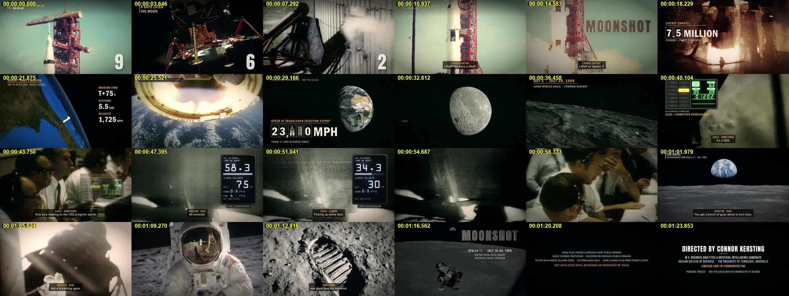
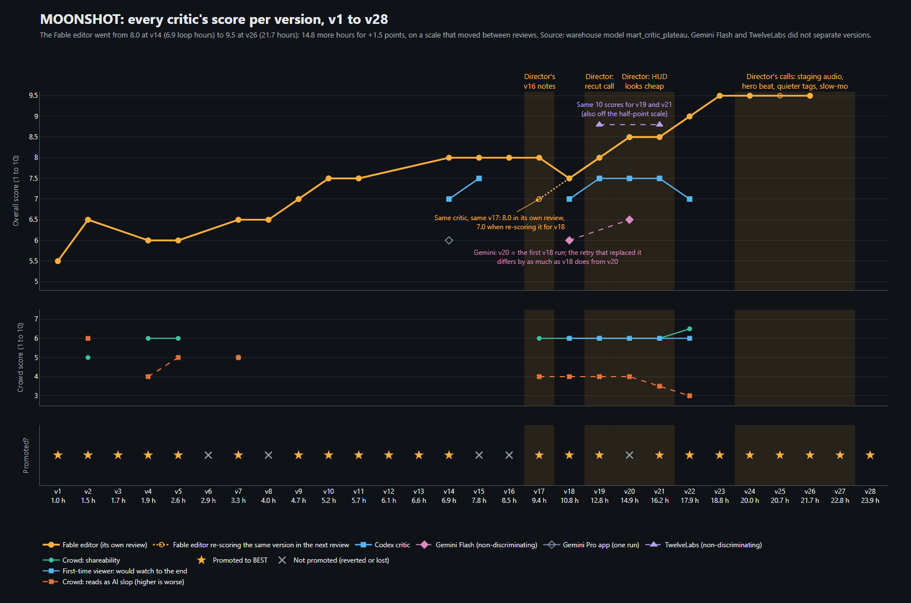
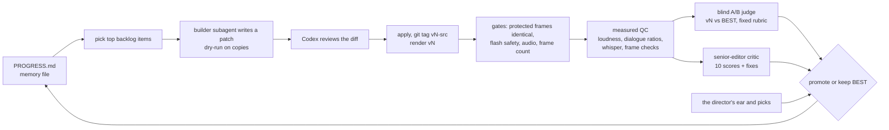
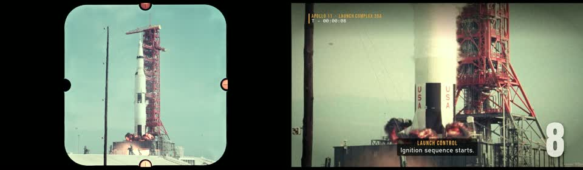
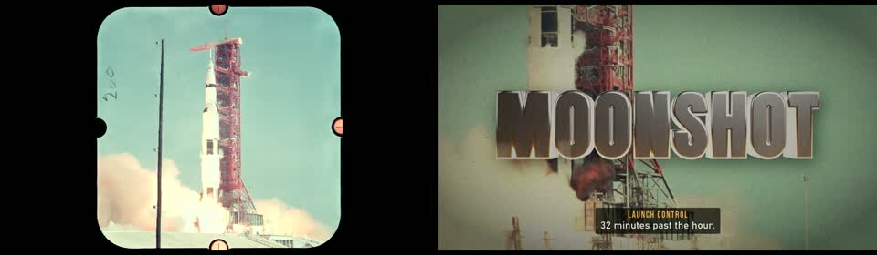
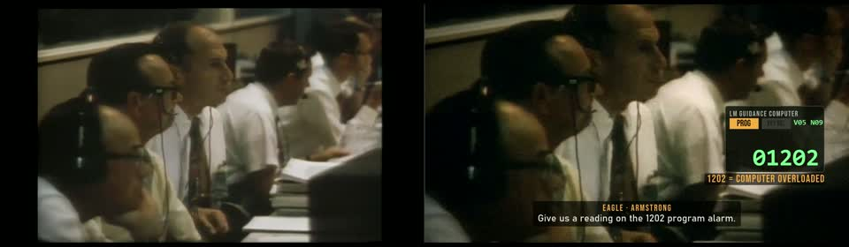
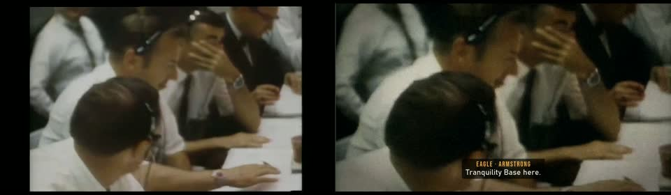
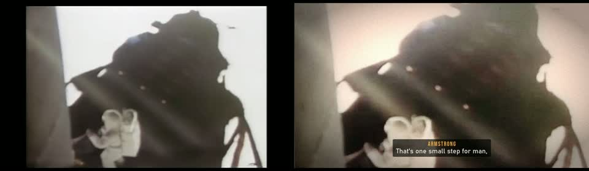

# MOONSHOT

A Claude Code agent loop cut this 87.5-second Apollo 11 trailer over 24 hours of loop time, October 7
to 9, 2026. The picture and voices are NASA footage, the 1969 mission audio and NASA-data 3D renders. The
music is public-domain orchestral recordings, and the sound effects come from a licensed library that isn't
in this repo. It ran on one laptop with no cloud renders. Each of its 28 versions was judged by reviewers
that didn't build it, and a human director made the calls the critics couldn't. The critics had limits too:
re-scored three times, the editor critic agreed with itself at an ICC of only 0.38, so small score gains
between versions are noise ([critic studies](#how-far-to-trust-the-critic)).



*The final cut (v28), one frame every 3.6 seconds, from the run's own QC contact sheet.*

## Result: v1 to v28

| | |
|---|---|
| Run | 2026-10-07 02:43 to 2026-10-09 00:06 EDT, seven ledger segments adding up to 24 h 01 m of loop time |
| Final | v28, 87.5 s, 2,100 frames at 24 fps, 1920×1080, −13.8 LUFS, −1.5 dBTP; `BEST.json` (in the run's work folder, not in this repo) pinned the file by sha256 and git tag |
| Versions exported | 28 (v1–v28), none overwritten; 1 reverted after losing a blind A/B (v6); 4 not promoted (v8, v15, v16, v20) |
| Senior-editor critic (Fable), overall | **v1 5.0 → v28 9.5** (same critic, same rubric, one sitting, in its final review). Across the run, each review on its own scale: 5.5 (v1) → 8.0 (v14) → 8.5 (v20, v21) → 9.0 (v22) → 9.5 (v23, v24, v26 and v28; v25 and v27 had no editor review). Steps of 0.5 to 1.0 are within the critic's re-ask noise ([below](#how-far-to-trust-the-critic)) |
| Final review (v28) | hook 8.5, pacing 8, variety 9, motion 9.5, type 9.5, colour 9.5, sound 8 (by structure, it can't hear), captions 8.5, story 9.5, overall 9.5; v28 better than v27 with no material regression, final pick v28 |
| Honest ceiling | 9.5 on "would a top YouTube editor ship this"; **7.5 against a trailer house's own standard** (see [MAKING-OF.md](MAKING-OF.md)) |
| Other critics' last pass | v22 for Codex (7.0) and the crowd (shareability 6.5, AI-slop 3.0, would-watch-to-end 6) |
| Blind A/B, v22 on | v22 beat v21 4-0 (3 ties); v23 beat v22 5-0 (2); v24 beat v23 1-0 (6); v26 beat v25 3-0 (4); v28 vs v27: 7 ties, no regression, and the final review picks v28. v25 and v27 were adopted on the director's own pick |
| Blind A/B, whole run | 161 section verdicts in 23 comparisons: the newer version won 39, lost 25, tied 97 |
| Agent effort | 5,114 Claude requests (Opus 3,461, Sonnet 1,409, Fable 244), 107 subagents, 491 Codex requests (an upper bound), 99 human messages; 97% of the tokens are cache reads, so they measure context, not work |
| Warehouse | dbt + DuckDB: 4 seeds, 48 models, 554 tests, PASS 605, WARN 1, ERROR 0 |
| Media | NASA video, photos and audio (public domain) + Musopen public-domain recordings + Sonniss GDC 2024 sound effects (licensed, not in the repo); the pre-rendered 3D frames and scans are not in the repo (see `pipeline/ASSETS.md`) |



**The ceiling, in the critic's own words.** The final review closes with: "v28 is a clean,
disciplined piece that a top YouTube editor would ship and a documentary distributor would run as a
teaser ... It is not yet trailer-house work, and the gap is specific." It names the gap: act 3 not
cut to the track (0.38 of cuts land on a beat), sound design that ducks a public-domain recording
under archive audio instead of designing every hit, the soft 16 mm scans carried as they are, six
seconds of CG explainer in an archive trailer, and 8.7 s of black credit cards at the end. "The craft
that is here is overlay craft ... what is missing is the re-cut, the mix and the restoration that
only come from someone sitting in a timeline with the music up." Its limits, briefly: the cut lives
in a frame compositor, so every change is a re-render and the reviewer could not hear the result;
the assets are public-domain scans and recordings, not a score written to the cut; and the budget
was 24 hours and 28 versions.

Two statements in that review are wrong, and are corrected here rather than in the review file:
- It says there was "no licensed SFX library". The mix does use one: the Sonniss GDC 2024 bundle
  (licensed for use in a production; it forbids redistribution and AI training, so the files are not
  in this repo).
- It says the MAX Q label strike is baked into the render and still open. It was fixed in v23: the
  ascent was re-rendered with no text, the labels are drawn as overlays, and their clearance from
  the rings and the trajectory line is gated.

Read the chart with its caveats. The editor's scale moved between reviews: it gave v17 an 8.0 in
its own review and 7.0 when it re-scored v17 inside the v18 review (the dotted line). The
Gemini Flash and TwelveLabs video critics are drawn, and labelled, as scorers that did not
separate versions: TwelveLabs gave v19 and v21 identical scores in all ten categories. The crowd
critic is coarse. From v14 to v26 the editor's score rose 1.5 points in 14.8 loop hours; the
last half point came after v22, in the all-out segment described in
[MAKING-OF.md](MAKING-OF.md).

## How the agent worked



- Memory lived in `PROGRESS.md` (in the run's work folder, not in this repo): the schedule, which version was BEST, the score table, the
  backlog, every instruction the human gave mid-run, tool traps and a resume point. The
  conversation was compacted several times, and each time the loop picked up from that file.
  Anthropic's
  [long-running harness post](https://www.anthropic.com/engineering/effective-harnesses-for-long-running-agents)
  describes the same idea for coding agents.
- `pipeline/build.py` turns three tables (SHOTS, DIALOG, CAPTIONS) into stems and a graded,
  captioned 1080p24 master. Most versions after v1 are a small patch script in
  `pipeline/patches/`, so you can read the edit's history as code. The overlays are in the
  `hud_v*.py` modules, the late versions' polish in `polish_v*.py`, and the loop's own gates and
  bookkeeping (`panel.py`, `promote.py`, `ledger.py`, the critic scripts) in `pipeline/loop/`.
- Each version went to several reviewers:
  - a senior-editor critic (Fable), which gave 10 scores and the fixes that would help most;
  - a blind A/B judge (Sonnet), which saw unlabeled frame strips per section with a fixed rubric
    (`pipeline/ab_rubric.md`) and never the key file;
  - "mean Twitter" commenters and a first-time viewer (dropped for a stretch, reinstated at v17);
  - Codex (OpenAI), as an adversarial reviewer of the patches (v14 to v23) and as a second critic;
  - scripts that measure the audio, the flashes and the frames.
- The blind A/B and the editor's review decided keep or revert between them, with logged
  exceptions, and from v17 on the director's own picks and approvals counted too. The judge can't hear and the editor can't hear, and the
  director's ear made the audio calls (0:33, 1:02, the v24 staging sound). Details in
  [MAKING-OF.md](MAKING-OF.md).
- Every version had to pass the same gates before promotion: the protected sections
  bit-identical before encoding, a WCAG 2.3.1 flash check, audio identical or changed only where
  intended, 2,100 frames, and a sha256-pinned manifest written by `promote.py`.
- The loop prompt is in [prompts/moonshot_loop_prompt.md](prompts/moonshot_loop_prompt.md), with
  local paths replaced by placeholders.

## Who decided what

From the run log, not from memory; each of the director's 99 messages is labelled in
`analytics/data/raw/interventions.csv`. The director, Connor Kersting:
- set the 24-hour budget, what counts toward it and the plateau rule, and approved the tools;
- caught the 0:33 digital-silence dropout and the late 1:02 music entry by ear, and approved
  the fixes by ear;
- rejected the overlays as looking cheap, which led to the 1969-hardware HUD;
- listened to three blind audio pairs: no preference on the countdown, the staging change
  chosen, the baseline kept on alarm and descent;
- picked the Earth-to-Moon hero beat over the real footage it replaced, and the RIFE slow-mo;
- asked for smaller, quieter on-screen disclosures, and said the outro was rushed and shaky.

The AI wrote and reviewed the code, ran the critics, and built the dbt warehouse in `analytics/`;
the director wrote none of the code or SQL. The critics' scores did not decide alone; the log marks
every override. When the director asked whether a CG astronaut footstep shot would work, the agent
advised against it, with reasons (see MAKING-OF.md).

## What broke

The full list is in [MAKING-OF.md](MAKING-OF.md#what-broke-and-what-it-taught). The short one:
- A one-frame white flash rendered black, then went missing. The decode pipe was re-timing
  frames, which also pushed everything after 56 s one frame late.
- The ignition "drop" barely rose over the countdown (1 LU louder in v8), because the music
  duck held through the launch lines. v10 put it 2.7 LU over the cold open.
- Stills-only critics reported one false alarm ("MILES TO THE MOON clipped") at least nine
  times. The loop fixed it with a known-non-issues file and an adjacent-frame rule.
- An audit found that mixes containing the licensed Sonniss effects had been sent to two external
  video critics. The uploads stopped, and the TwelveLabs data setting was changed at the director's
  request.
- Two video critics (Gemini Flash, TwelveLabs) didn't separate versions, and the story about
  Gemini's identical scores turned out to rest on a file a retry had overwritten. The warehouse
  caught that.
- The alpha craft apps barely made it into the final pipeline. EffectCraft built the v1 title over
  MCP and Blender replaced it in v3; PhotoCraft made thumbnail candidates.

## Raw vs final

These pairs are from the v12 export (the raw sources at the same edit points, beside the finished
cut). The raw-vs-final side-by-side has not been rebuilt for v28.

| | |
|---|---|
|  |  |
|  |  |
|  | |

## Analytics

[`analytics/`](analytics/README.md) turns the run's logs into metadata-only tables (requests,
scores, A/B votes, audio QC, the director's picks), models them in dbt + DuckDB with a test suite
that checks grain, orphan rows, enums and reconciliation to the source, and renders an offline
dashboard, the plateau chart above and a run-accounting report. It was refreshed through v28 on
2026-10-09. [`showcase/`](showcase/README.md) holds two tools (a version explorer and a supercut)
that were built and self-tested but not run on the final.

## Reproduce

This repo is a record of one run more than a turnkey tool. Rebuilding the cut takes several
manual steps, depends on tools that aren't included, and needs binary assets that aren't in the
repo (`pipeline/ASSETS.md` lists them, with the recipe and hash for each). It was built and run on
Windows 11 only. The graphics use two Windows system fonts (Bahnschrift, Consolas). You need
Python 3.11+ with numpy, Pillow and scipy, ffmpeg 6+, and Blender 5.x; the v20 and later ignition
ramp and the v27 slow-mo come from RIFE v4.6 (rife-ncnn-vulkan), but they are tracked assets, so
a build only needs RIFE to regenerate them.

1. Set `CRAFTWORK` to an empty workspace folder and run `python pipeline/fetch_assets.py`. It
   downloads the NASA media, the Commons music and the NASA Moon Kit into the layout `build.py`
   expects. Its docstring lists the things to get by hand: the Sonniss bundle (into
   `$CRAFTWORK/sfx/sonniss-gdc2024`), the Blue Marble texture, the Poly Haven HDRI, and the Anton
   and Bebas Neue fonts. The 16 Commons scans and the Blue Marble clouds texture are needed only
   to rebuild the v24 and v25 assets (CREDITS.md lists them).
2. Render or restore the pre-rendered 3D plates and clips named in `pipeline/ASSETS.md` (the
   Blender scripts are in `pipeline/blender/`, run as
   `blender -b --factory-startup --python <script> -- <args>`). Their manifests are in
   `pipeline/asset_manifests/`, and `build.py` refuses to build on a mismatch.
3. Synthesise the heartbeat, tick and alarm stem:
   `python pipeline/audio/score.py --cues pipeline/cues.json --out $CRAFTWORK/inbox/moonshot/work/audio`.
4. Clean the mission-audio windows listed in `build.py`'s DIALOG table into
   `$CRAFTWORK/inbox/moonshot/work/restore/`. The run used `craft_tools.restore audio` (RNNoise,
   EQ, compression), which isn't in this repo. Any decent speech cleanup at 48 kHz will do, but
   the levels will differ.
5. Build and check (v28 shown; the version number is the argument):

```bash
python pipeline/build.py shots 28 && python pipeline/build.py dialog 28 && python pipeline/build.py music 28
python pipeline/build.py comp 28 && python pipeline/build.py mix 28
python pipeline/qc.py 28 && python pipeline/audio_qc.py 28    # audio_qc's whisper pass needs CRAFT_TOOLS
python pipeline/flashqc2.py <the encoded mp4>                  # flash-safety check; must pass
```

The exported pipeline was checked for syntax and for leftover personal paths, but not rebuilt from
a clean checkout of this repo. The scripts in `pipeline/patches/` are history: each turned
version N-1 into version N in the original work folder, and `pipeline/build.py` is already the
final v28.

## Credits

All footage, photographs and mission audio are NASA works, public domain in the US. The music is
three Musopen public-domain recordings: Dvořák's "New World" finale and Largo, and Beethoven's
Egmont overture (Czech National Symphony Orchestra). Versions v2 to v12 used Holst's "Mars" in a
US Air Force Band recording; v13 replaced it over an unconfirmed arrangement copyright, so v13 and
later are the ones cleared on the music side. The sound effects come from the Sonniss GDC 2024
bundle; they're in the mix but not in this repo, and the licence forbids redistributing them or
using them to train AI. Fonts: Anton and Bebas Neue (SIL OFL). The full list with links is in
[CREDITS.md](CREDITS.md).

**Not affiliated with or endorsed by NASA.** No NASA insignia is used. The trailer's end credits
mark it as cut by an AI agent from NASA source material.

## Related work

From a 15-minute search on 2026-10-07 (details in [RELATED-WORK.md](RELATED-WORK.md); not
re-run since):
- Anthropic's [long-running agent harness](https://www.anthropic.com/engineering/effective-harnesses-for-long-running-agents) uses the progress-file loop this run follows, for coding.
- [Kinocut](https://github.com/KyaniteLabs/kinocut) is an ffmpeg editing MCP with quality and release checkpoints.
- [DaVinci Resolve MCP](https://github.com/Tooflex/davinci-resolve-mcp) and a [Premiere Pro MCP](https://glama.ai/mcp/servers/@hetpatel-11/Adobe_Premiere_Pro_MCP/blob/b9fa9862ecb7be8d717cd63c4b32be594e13bd6c/README.md) each put one editor behind MCP.
- [Blender MCP v2](https://www.strayspark.studio/blog/blender-mcp-server-v2-vision-async-jobs-cc0-assets) lets an agent render a preview, look at it and adjust.
- invideo describes [overnight generated-video pipelines](https://invideo.io/faq/how-do-you-set-up-an-automated-overnight-ai-video/) with a QA agent.

In that search I didn't find another public run that pairs a multi-hour progress-file loop with
blind-A/B keep/revert and licence-logged archival footage plus a raw-vs-final cut. That's about
one short search, not the field.

## How far to trust the critic

Two studies ran after the loop, on 2026-10-09. The code, raw results and write-ups are in
[`analytics/studies/`](analytics/studies/README.md).
- **Study 1, repeatability.** The editor critic re-scored 8 versions (v1 to v13) three times each:
  ICC(2,1) = 0.38 (95% CI -0.20 to 0.67), well short of the 0.75 set in advance. Repeats rarely differed
  by more than 0.5; the problem is that the critic barely told those versions apart (their means span
  6.33 to 7.17, and v1 re-scored 6.67 against its original 5.5). A 0.5 to 1.0 move between adjacent
  versions is within re-ask noise. v28 was not in the study, so read the score table above as the
  critic's own reading, not a measured gain.
- **Study 2, position bias.** The blind A/B judge picked the top strip in 18 of 38 decisive calls
  (randomization p = 0.67): no position bias found.

## Not done

- A viewer test with people (the kit exists; the director deferred it until after the 24 hours).
- A vertical teaser, 15 and 30 second cutdowns and a poster.
- A rebuilt raw-vs-final video, a version-explorer page and a supercut from v28.
- Captions: the SRT and VTT files were made on the v16 timeline and not regenerated.

## Licence

Code and docs: MIT ([LICENSE](LICENSE)). Media is not included; see CREDITS.md.
